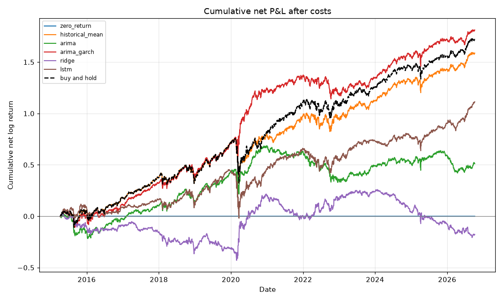
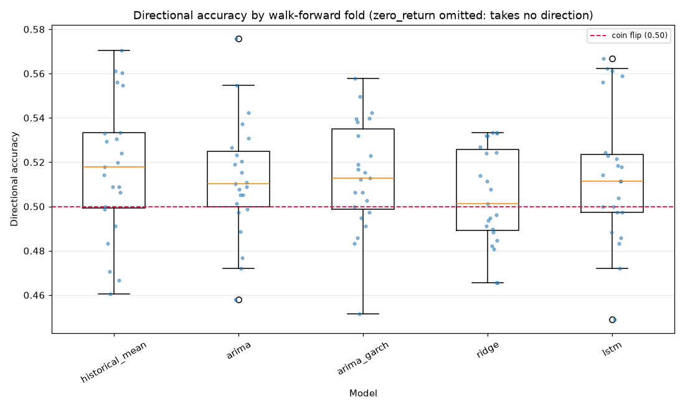

# equity-forecast

[](https://github.com/ahyanadatia/equity-forecast/actions/workflows/ci.yml)

[](LICENSE)

**Does the extra complexity of an LSTM buy anything over classical models and a naive baseline,
once you evaluate honestly and account for transaction costs?**

**No.** On six large US stocks (AAPL, JPM, KO, XOM, MSFT, PG), across 23 walk-forward folds from
April 2015 to October 2026, forecasting one-day-ahead log returns with six models (ZeroReturn,
HistoricalMean, ARIMA, ARIMA-GARCH, Ridge, LSTM), **no model's forecast errors are
distinguishable from a random walk's** (smallest Diebold-Mariano p = 0.16, ARIMA-GARCH; the
LSTM's is 0.67). Directional accuracy sits between 51% and 53%. One strategy does finish ahead of
buy-and-hold after costs (ARIMA-GARCH, net Sharpe 1.03 against 0.87), but with no measurable
accuracy edge behind it that is drift or luck rather than skill, and the report says so. The LSTM
finishes behind buy-and-hold (net Sharpe 0.59).

Because "no model found anything" is exactly what a *broken* harness also reports, the repo
ships two control runs on simulated data: one with no signal planted, where the pipeline
correctly finds nothing, and one with signal planted, where it finds it. See
[Controls](#controls-the-harness-finds-signal-only-when-it-is-there).

## Headline results

From [`results/latest/summary.md`](results/latest/summary.md) (run `real-market`: 23 folds,
6 tickers, 5 bps costs, seed 42; split- and dividend-adjusted daily prices from Yahoo Finance,
downloaded on 22 November 2026 by [`real-data.yml`](.github/workflows/real-data.yml)):

| Model | RMSE (mean±std) | DirAcc (mean±std) | IC (mean±std) | DM p vs ZeroReturn | Net Sharpe | Max DD | Avg turnover |
| --- | --- | --- | --- | --- | --- | --- | --- |
| zero_return | 0.01502 ± 0.00480 | 0.0000 ± 0.0000 | n/a | n/a | 0.00 | 0.0000 | 0.000 |
| historical_mean | 0.01500 ± 0.00481 | 0.5291 ± 0.0215 | 0.0191 ± 0.0436 | 0.169 | 0.84 | 0.4337 | 0.001 |
| arima | 0.01502 ± 0.00478 | 0.5184 ± 0.0271 | 0.0175 ± 0.0637 | 0.895 | 0.32 | 0.3575 | 0.602 |
| arima_garch | 0.01500 ± 0.00478 | 0.5285 ± 0.0232 | 0.0222 ± 0.0544 | 0.156 | 1.03 | 0.2330 | 0.181 |
| ridge | 0.01506 ± 0.00475 | 0.5075 ± 0.0229 | 0.0070 ± 0.0477 | 0.449 | -0.12 | 0.4679 | 0.965 |
| lstm | 0.01501 ± 0.00482 | 0.5214 ± 0.0272 | 0.0236 ± 0.0462 | 0.667 | 0.59 | 0.4730 | 0.165 |

RMSE, DirAcc and IC are means ± standard deviations across the 23 walk-forward folds — no
number is reported without its dispersion. `DM p vs ZeroReturn` is the Diebold-Mariano p-value
against the random-walk baseline; **none clears 5%**. `zero_return` shows DirAcc 0.00 by
construction rather than because it is anti-predictive: it forecasts exactly zero, expressing
no direction at all, and an exactly-zero forecast is scored as a miss rather than credited with
a coin flip. Its IC is undefined for the same reason.





How to read this:

- **Accuracy.** Every model's RMSE is within 0.3% of the zero forecast's. Nothing here predicts
  tomorrow's return better than "no change".
- **Costs decide the ranking.** Ridge trades the most (0.97 average daily turnover) and ends
  with a negative net Sharpe (-0.12). ARIMA's gross Sharpe of 0.87 falls to 0.32 net at 0.60
  turnover.
- **The one apparent winner.** ARIMA-GARCH ends with the best net Sharpe (1.03, against 0.87
  for buy-and-hold) and the smallest drawdown among the profitable models (23%). Its forecast
  errors are still not distinguishable from the baseline's (p = 0.16), so the P&L is not
  evidence of forecasting skill.
- **The LSTM.** It has the highest mean information coefficient (+0.024, fold-level t = 2.45),
  but folds share most of their training data and this is the best of five models, so that
  figure overstates the evidence. On the test this repo stands behind it is nowhere near
  significant (p = 0.67), and it trails buy-and-hold after costs.

## Controls: the harness finds signal only when it is there

Both controls run the same pipeline, models and 23 folds over a simulated universe from
`scripts/make_synthetic_universe.py`: six tickers named `SIMA`–`SIMF` over 2010–2026 with
GARCH(1,1) conditional variance, Student-t(5) innovations and a common factor.

### Null control: no signal planted, none found

[`results/null/summary.md`](results/null/summary.md). No exploitable predictability is planted
in the conditional mean, so the correct answer is that nothing beats the baseline:

| Model | RMSE (mean±std) | DirAcc (mean±std) | IC (mean±std) | DM p vs ZeroReturn | Net Sharpe | Max DD | Avg turnover |
| --- | --- | --- | --- | --- | --- | --- | --- |
| zero_return | 0.01329 ± 0.00450 | 0.0000 ± 0.0000 | n/a | n/a | 0.00 | 0.0000 | 0.000 |
| historical_mean | 0.01329 ± 0.00449 | 0.5174 ± 0.0310 | 0.0075 ± 0.0270 | 0.453 | 0.74 | 0.3248 | 0.000 |
| arima | 0.01330 ± 0.00449 | 0.5124 ± 0.0263 | -0.0022 ± 0.0403 | 0.655 | 0.42 | 0.3380 | 0.188 |
| arima_garch | 0.01329 ± 0.00451 | 0.5138 ± 0.0248 | 0.0083 ± 0.0499 | 0.626 | 0.31 | 0.3761 | 0.343 |
| ridge | 0.01334 ± 0.00455 | 0.5046 ± 0.0222 | -0.0156 ± 0.0588 | 0.104 | -0.18 | 0.8981 | 0.778 |
| lstm | 0.01330 ± 0.00449 | 0.5141 ± 0.0308 | 0.0026 ± 0.0409 | 0.975 | 0.60 | 0.3344 | 0.082 |

Smallest Diebold-Mariano p = 0.10 (Ridge); directional accuracy clusters at 51%.

### Positive control: signal planted, signal found

A null result is only worth something if the machinery that produced it can find signal when
signal exists. [`results/control/summary.md`](results/control/summary.md) is the same pipeline,
the same models and the same 23 folds run over an identical universe with one change: an AR(1)
term with `phi = 0.15` planted in each stock's returns — far stronger than anything daily
equity returns show, and deliberately so.

| Model | RMSE (mean±std) | DirAcc (mean±std) | IC (mean±std) | DM p vs ZeroReturn | Net Sharpe | Max DD | Avg turnover |
| --- | --- | --- | --- | --- | --- | --- | --- |
| zero_return | 0.01242 ± 0.00314 | 0.0000 ± 0.0000 | n/a | n/a | 0.00 | 0.0000 | 0.000 |
| historical_mean | 0.01241 ± 0.00312 | 0.5136 ± 0.0328 | 0.0063 ± 0.0181 | 0.052 | 1.09 | 0.2949 | 0.001 |
| arima | 0.01233 ± 0.00312 | 0.5382 ± 0.0268 | 0.1131 ± 0.0518 | 0.000 | 1.53 | 0.1544 | 0.715 |
| arima_garch | 0.01232 ± 0.00314 | 0.5429 ± 0.0238 | 0.1218 ± 0.0547 | 0.001 | 1.52 | 0.1973 | 0.850 |
| ridge | 0.01233 ± 0.00308 | 0.5341 ± 0.0228 | 0.1045 ± 0.0502 | 0.003 | 1.16 | 0.1977 | 0.817 |
| lstm | 0.01237 ± 0.00308 | 0.5302 ± 0.0209 | 0.0744 ± 0.0553 | 0.017 | 1.39 | 0.1360 | 0.527 |

Every model that reads lagged returns finds it — ARIMA-GARCH reaches IC +0.12 and 54.3%
directional accuracy at p = 0.001, and all four beat the baseline at the 5% level with
**negative** DM statistics (the sign that means "better"). `historical_mean`, which has no
mechanism for exploiting autocorrelation, does not (p = 0.052). The evaluation, the significance
test and the backtest all work. They simply find nothing in the efficient universe, because
there is nothing there.

```bash
python scripts/make_synthetic_universe.py
equity-forecast run --config configs/synthetic.yaml         # the null control
equity-forecast run --config configs/synthetic_signal.yaml  # the positive control
```

## Method

### What is being predicted

The target is the **one-day-ahead close-to-close log return**, not the price:

    y_t = log(P_t / P_{t-1})

This is the single most important design decision in the project, and the thing v1 got wrong.
Daily prices are close to a random walk, so a model that predicts "tomorrow's price is today's
price" scores an excellent RMSE while forecasting precisely nothing. Scoring on returns removes
that free lunch, and every result is reported against a `ZeroReturn` baseline that predicts
exactly zero — the random walk made explicit — so any claimed edge has to be an edge over
"assume tomorrow is a coin flip".

The horizon `h` is configurable; `h = 1` throughout this README. For `h > 1` the target is the
cumulative log return `sum_{i=0}^{h-1} r_{t+i}` and the backtest holds each position for `h`
days so the bets do not overlap.

### Features

Row `t` of the dataset is dated by the day the target is *realised*, and every feature on that
row is computed only from returns up to and including `t-1`:

| Feature | Definition |
| --- | --- |
| `ret_lag_1 … ret_lag_k` | lagged log returns, `k = 10` by default |
| `roll_mean_w`, `roll_std_w` | rolling mean and standard deviation of returns, `w ∈ {5, 21, 63}` |
| `max_dd_21` | maximum drawdown of the cumulative return path over the last 21 days |
| `rvol_21` | annualised realised volatility, `sqrt(252 · mean(r²))` over 21 days |
| `dow_mon … dow_fri` | one-hot weekday of date `t` (known in advance, so it carries no look-ahead) |

Features are standardised inside each fold using **training-fold statistics only**. The
day-of-week indicators are left alone.

### Walk-forward validation

v1 used one train/test split, which is one sample of the world. v2 uses rolling-origin
(walk-forward) validation with an embargo between train and test:

```
                    |<-- gap -->|
fold 0  [=========== train ===========]  x  [== test ==]
fold 1  [============== train ============]  x  [== test ==]
fold 2  [================= train =============]  x  [== test ==]
fold 3  [==================== train ==============]  x  [== test ==]
                                                        ...
        2010 ------------------------------------------------> 2026

        expanding mode: train start is pinned to 2010 and the window grows
        rolling mode:   train start slides so the window stays a fixed length
        x = gap_days trading days embargoed, so a lagged feature at the first
            test date cannot reach back into the training targets
```

Each test block is six months of trading days; blocks are contiguous, non-overlapping, and tile
the post-initial-train period. Models are refitted from scratch on every fold.

### Models

| Model | What it is | Why it is here |
| --- | --- | --- |
| `zero_return` | predicts exactly 0 | the random walk; the bar everything must clear |
| `historical_mean` | predicts the training-set mean return per ticker | catches "the edge is just drift" |
| `arima` | `statsmodels` ARIMA(p,0,q) on returns | the classical linear time-series answer |
| `arima_garch` | `arch` ARX mean + GARCH(1,1) with Student-t innovations | mean *and* conditional variance |
| `ridge` | Ridge regression on the lagged feature matrix | the linear baseline that often embarrasses deep models |
| `lstm` | Keras LSTM over 20-day feature sequences, pooled with a ticker embedding | the complexity whose value is in question |

Hyperparameters live in YAML, never in code.

**ARIMA and GARCH are fitted once per fold but still forecast one step ahead.** A naive "fit
once, forecast the whole six-month block" implementation produces a multi-step forecast that
decays to the unconditional mean within days, which would make ARIMA indistinguishable from
`historical_mean` by construction and would be a strawman comparison. Instead the parameters
are estimated once on the training block and then *re-applied* to the extended return series
(`statsmodels` `.apply(refit=False)`, `arch` `.fix()`), yielding genuine one-step-ahead
forecasts. Only returns up to `t-1` inform the forecast for `t`. The trade-off — parameters
frozen within a fold rather than re-estimated daily — is deliberate and documented.

**GARCH is used as a variance model, not a price model.** v1 compared GARCH against ARIMA and
the LSTM as though it forecast prices; it does not. Here the ARX component supplies the point
forecast and GARCH supplies the conditional volatility, which is exposed through `predict_vol`
and feeds the optional volatility-targeted backtest.

### Metrics

Reported per fold, per ticker, then aggregated as mean ± standard deviation — never a single
number without its dispersion.

- **RMSE / MAE** — accuracy of the return forecast.
- **Directional accuracy** — fraction of days the sign is right, excluding zero-return days.
  An exactly-zero forecast is scored as a miss rather than a coin flip, so `ZeroReturn` scores
  0.00 rather than being credited 50% for having no opinion.
- **Information coefficient** — Spearman rank correlation between forecast and realised return.
- **Hit rate vs. baseline** — fraction of days the model's absolute error beats the baseline's.
- **Diebold-Mariano** — a test of *equal predictive accuracy* against `ZeroReturn`, with
  Newey-West truncation at `h-1` lags and the Harvey-Leybourne-Newbold small-sample correction.
  A negative statistic means the model has the lower loss; the p-value alone says only that the
  two differ, so the report always states the direction.

The headline DM test is computed on the **equal-weight cross-sectional mean of the loss
differential** — one observation per date. Pooling every `(date, ticker)` error into a single
test would badly overstate significance, because six stocks' same-day errors are strongly
cross-sectionally correlated. Per-ticker tests are reported alongside.

### Backtest

The position for date `t` is a function of the forecast *for* `t`, which was made at `t-1`:

    position_t = sign(forecast_t)          # optionally 0 when |forecast_t| < threshold
    pnl_t      = position_t · return_t
    turnover_t = |position_t − position_{t−1}|
    cost_t     = turnover_t · cost_bps / 10000
    net_t      = pnl_t − cost_t

Equal-weight across tickers, daily rebalancing, 5 bps per unit of turnover by default, and both
gross and net are reported — for a daily-rebalanced sign signal the gap between them is the
entire question. Optional volatility targeting scales the position by
`target_vol / forecast_vol`, capped at ±2, using the GARCH forecast.

Reported statistics: annualised return, annualised volatility, Sharpe, Sortino, maximum
drawdown, average daily turnover and percentage of days in the market. Maximum drawdown is
computed on the cumulative *sum* of daily log-return contributions, not a compounded equity
curve.

## Limitations

These bound what the headline finding can be taken to mean.

1. **One run on six stocks is a small experiment.** The headline is a statement about six
   hand-picked large caps over one eleven-year window. It does not show that returns are
   unforecastable in general, and with five models compared against the baseline, an apparent
   winner such as ARIMA-GARCH's net Sharpe is what multiple comparisons produce by chance.
2. **Survivorship and selection.** The universe is six large, currently-listed US names
   chosen by hand. They survived to 2026, and any strategy tested on them inherits that. A real
   study needs a point-in-time index membership file.
3. **Daily close-to-close only.** No intraday data, so nothing here speaks to shorter horizons
   where microstructure effects live.
4. **No slippage or market-impact model.** Costs are a flat bps charge on turnover. Real
   execution of a daily-rebalanced long/short book would face spread, impact and borrow costs
   that scale with size.
5. **No regime conditioning.** Models are fitted on whatever the training window contains, and
   2010–2026 spans several very different volatility regimes. A model that works only in one of
   them is averaged into mediocrity here.
6. **Small universe, few folds.** Cross-sectional averaging over six names, and per-fold
   dispersion estimated from a handful of folds whose training windows overlap heavily. Fold
   errors are therefore not independent, so a t-test across folds would overstate confidence;
   the significance claims in this repo come from Diebold-Mariano on the daily series, not from
   fold counts.
7. **A fixed, small hyperparameter grid.** No extensive search, deliberately — searching hard
   over a walk-forward test set is a good way to manufacture an edge that does not exist.
8. **One asset class, one country, one frequency.**

## How to run

```bash
uv venv --python 3.11 && uv pip install -r requirements.lock && uv pip install -e .
equity-forecast smoke                                 # offline smoke run, ~1 min, uses committed fixtures
equity-forecast run --config configs/default.yaml     # the real study; downloads and caches prices
```

To reproduce the two control runs (no network needed):

```bash
python scripts/make_synthetic_universe.py
equity-forecast run --config configs/synthetic.yaml         # the null control
equity-forecast run --config configs/synthetic_signal.yaml  # the positive control
```

Results land in `results/<run_id>/` and the headline artefacts are copied to the config's
`latest_dir`: `results/latest/` for the real study, `results/null/` and `results/control/` for the
controls.
`equity-forecast report --run-id <id>` re-renders a previous run from disk,
`equity-forecast run --models ridge,lstm` restricts the comparison, and
`equity-forecast fetch --config <cfg>` populates the price cache without running anything.

Development:

```bash
ruff check src tests scripts && ruff format --check src tests scripts
mypy --strict src
pytest -q          # 274 tests, ~50s, no network. `pytest -m ""` adds the slow end-to-end run.
```

### Reproducibility

Same config, same seed, same machine → identical metrics. `metrics_summary.csv` is byte-for-byte
identical across repeated runs of `configs/synthetic.yaml`. Every source of randomness is seeded
from one place (`seeding.set_global_seeds`), TensorFlow op determinism is enabled, and the LSTM
trains with `shuffle=False`.

Two known limits. On GPU some cuDNN kernels remain nondeterministic even with op determinism
enabled, so bitwise reproducibility is a CPU guarantee; the pinned dependency is `tensorflow-cpu`
for that reason. And results are only comparable within a pinned dependency set —
`requirements.lock` exists so that "same seed" also means "same BLAS, same TensorFlow, same
`statsmodels` optimiser".

### Repository layout note

Three modules exist that the original specification did not name: `config.py` (frozen
dataclasses for every YAML knob, so a typo fails at load time rather than silently changing an
experiment), `seeding.py` (one place that seeds Python, NumPy and TensorFlow) and `pipeline.py`
(the walk-forward driver, kept out of `cli.py` so it is testable without invoking a CLI).

## What v1 did, and what changed

v1 was a notebook comparing ARIMA, GARCH and an LSTM on 14 years of daily data for AAPL, JPM
and KO, scored by RMSE and MAE of the predicted **price** on a single train/test split.

| v1 | v2 | Why it mattered |
| --- | --- | --- |
| Predicted price levels | Predicts log returns, always against a random-walk baseline | Price is near-random-walk; "tomorrow = today" wins on RMSE while forecasting nothing |
| One train/test split | Walk-forward folds with an embargo | One split is one sample of the world; dispersion across folds is most of the story |
| RMSE and MAE only | Directional accuracy, IC, hit rate, Diebold-Mariano, and a cost-aware backtest | Accuracy is not tradeability, and a difference without a significance test is an anecdote |
| GARCH compared as a price model | GARCH forecasts variance, and feeds volatility targeting | GARCH is a variance model; comparing it on price RMSE is a category error |
| Notebook only, no seeds, no tests | Installable package, CLI, YAML configs, fixed seeds, 275 tests, CI | A result you cannot re-run is not a result |
| No transaction costs | 5 bps per unit of turnover, gross and net both reported | A daily-rebalanced sign signal lives or dies on costs |

The notebook that remains (`notebooks/01_results_walkthrough.ipynb`) only *reads* artefacts the
package produced. It contains no modelling logic.
