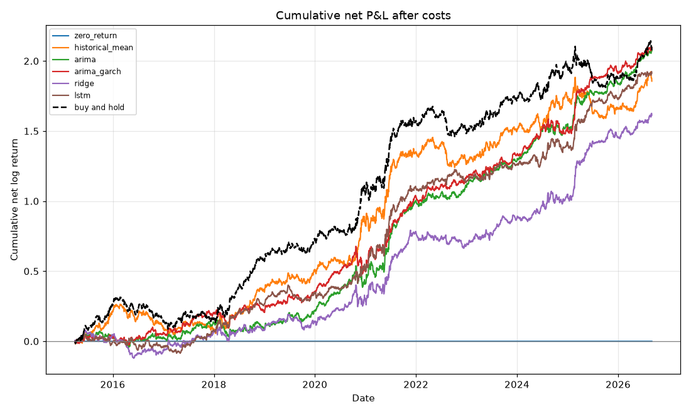
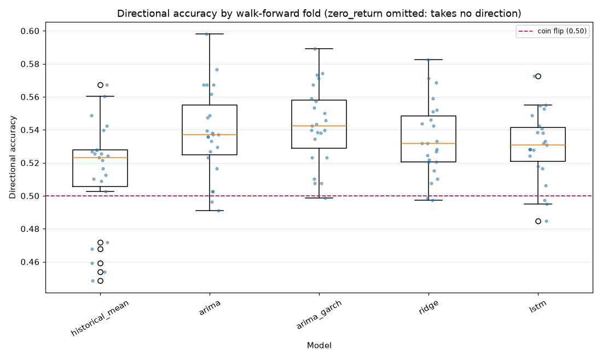
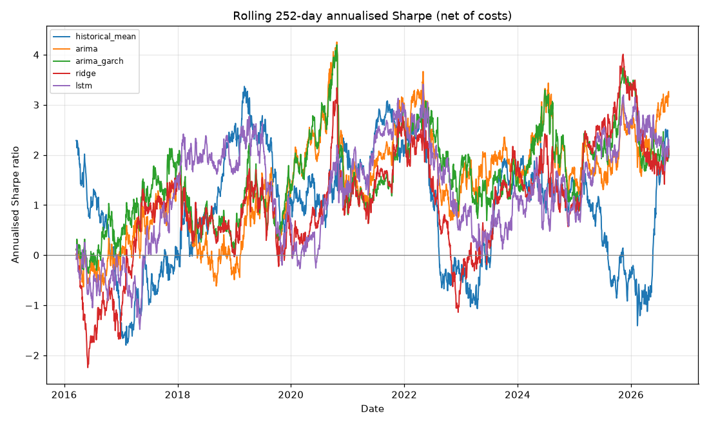
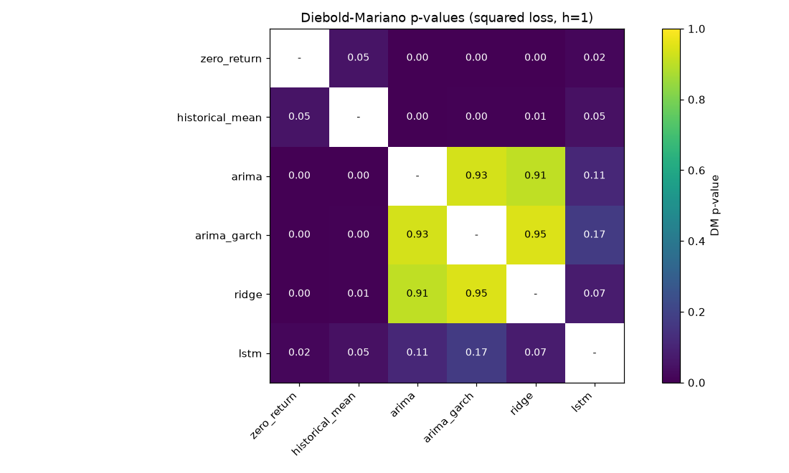

# equity-forecast run `synthetic-signal`

> POSITIVE CONTROL ON SIMULATED DATA - NOT A MARKET RESULT. Identical to configs/synthetic.yaml except an AR(1) term with phi = 0.15 is planted in each stock's returns - far stronger than anything daily equity returns show, and deliberately so. Any model that reads lagged returns should find it. This run exists to demonstrate that the walk-forward evaluation, the Diebold-Mariano test and the backtest detect forecastable structure when it is there, which is what makes the null result on configs/synthetic.yaml a statement about the data rather than about the code.

## Run metadata

| Field | Value |
| --- | --- |
| Run ID | synthetic-signal |
| Tickers | SIMA, SIMB, SIMC, SIMD, SIME, SIMF |
| Evaluated range | 2015-04-02 -> 2026-09-01 |
| Folds | 23 |
| Models | zero_return, historical_mean, arima, arima_garch, ridge, lstm |
| Forecast horizon | 1 trading day(s) |
| Split | expanding, 5y initial train, 6m test blocks, 1d embargo |
| Cost assumption | 5.0 bps per unit of turnover; entry threshold 0; vol target none |
| Seed | 42 |

## Headline

| Model | RMSE (mean±std) | DirAcc (mean±std) | IC (mean±std) | DM p vs ZeroReturn | Net Sharpe | Max DD | Avg turnover |
| --- | --- | --- | --- | --- | --- | --- | --- |
| zero_return | 0.01242 ± 0.00314 | 0.0000 ± 0.0000 | n/a | n/a | 0.00 | 0.0000 | 0.000 |
| historical_mean | 0.01241 ± 0.00312 | 0.5136 ± 0.0328 | 0.0063 ± 0.0181 | 0.052 | 1.09 | 0.2949 | 0.001 |
| arima | 0.01233 ± 0.00312 | 0.5382 ± 0.0268 | 0.1131 ± 0.0518 | 0.000 | 1.53 | 0.1544 | 0.715 |
| arima_garch | 0.01232 ± 0.00314 | 0.5429 ± 0.0238 | 0.1218 ± 0.0547 | 0.001 | 1.52 | 0.1973 | 0.850 |
| ridge | 0.01233 ± 0.00308 | 0.5341 ± 0.0228 | 0.1045 ± 0.0502 | 0.003 | 1.16 | 0.1977 | 0.817 |
| lstm | 0.01237 ± 0.00308 | 0.5302 ± 0.0209 | 0.0744 ± 0.0553 | 0.017 | 1.39 | 0.1360 | 0.527 |

_RMSE, DirAcc and IC are means ± standard deviations across the 23 walk-forward folds. `DM p vs ZeroReturn` is the Diebold-Mariano p-value of the model's squared forecast errors against the zero_return baseline; a value above 0.05 means the difference is indistinguishable from noise. Net Sharpe, max drawdown and average turnover come from the cost-aware backtest. `zero_return` shows DirAcc 0.00 by construction, not because it is anti-predictive: it forecasts exactly zero, expressing no direction at all, and an exactly-zero forecast is scored as a miss rather than credited with a coin flip. Its IC is undefined for the same reason - a constant forecast has no rank correlation._

## Findings

1. Per-fold directional accuracy: historical_mean above 0.50 in 18/23 folds (mean 0.514), closer to the truth than zero_return in 15/23 folds; arima above 0.50 in 21/23 folds (mean 0.538), closer to the truth than zero_return in 18/23 folds; arima_garch above 0.50 in 22/23 folds (mean 0.543), closer to the truth than zero_return in 18/23 folds; ridge above 0.50 in 21/23 folds (mean 0.534), closer to the truth than zero_return in 13/23 folds; lstm above 0.50 in 20/23 folds (mean 0.530), closer to the truth than zero_return in 16/23 folds.
2. Diebold-Mariano vs ZeroReturn (squared loss): arima, arima_garch, ridge and lstm beat the baseline at the 5% level. All p-values: historical_mean p=0.052, arima p=0.000, arima_garch p=0.001, ridge p=0.003, lstm p=0.017.
3. Best net Sharpe among the trading models: arima at 1.53 (gross 2.32, a 0.79 give-up); average daily turnover of 0.71 at 5.0 bps costs roughly 901 bps of return per year; the do-nothing zero_return book scores 0.00; buy-and-hold over the same window scores 1.19. That P&L survives the cost drag. Whether any accuracy edge supports it is the bottom line's question.
4. Mean information coefficient (Spearman) per model across folds: historical_mean +0.0063, arima +0.1131, arima_garch +0.1218, ridge +0.1045, lstm +0.0744. The strongest (arima_garch) has a fold-level t-statistic of 10.68 over 23 folds (p=0.000), i.e. distinguishable from zero at the 5% level. Read that p-value as an order of magnitude, not as inference: walk-forward folds share most of their training data so their ICs are not independent, and this is the best of 5 models, which biases it upward. The Diebold-Mariano tests on the daily series are the significance claims this report stands behind.
5. Bottom line: arima both beats the ZeroReturn baseline on forecast accuracy at the 5% level and earns a positive net Sharpe of 1.53 after 5.0 bps of costs. That is a real but small edge on one sample of one universe, and it needs out-of-sample confirmation before it means anything.

## Walk-forward folds

| fold_id | train_start | train_end | test_start | test_end | n_train_days | n_test_days |
| --- | --- | --- | --- | --- | --- | --- |
| 0 | 2010-04-01 | 2015-03-31 | 2015-04-02 | 2015-10-01 | 1304 | 131 |
| 1 | 2010-04-01 | 2015-09-30 | 2015-10-02 | 2016-04-01 | 1435 | 131 |
| 2 | 2010-04-01 | 2016-03-31 | 2016-04-04 | 2016-09-30 | 1566 | 130 |
| 3 | 2010-04-01 | 2016-09-29 | 2016-10-03 | 2017-03-31 | 1696 | 130 |
| 4 | 2010-04-01 | 2017-03-30 | 2017-04-03 | 2017-09-29 | 1826 | 130 |
| 5 | 2010-04-01 | 2017-09-28 | 2017-10-02 | 2018-03-30 | 1956 | 130 |
| 6 | 2010-04-01 | 2018-03-29 | 2018-04-02 | 2018-10-01 | 2086 | 131 |
| 7 | 2010-04-01 | 2018-09-28 | 2018-10-02 | 2019-04-01 | 2217 | 130 |
| 8 | 2010-04-01 | 2019-03-29 | 2019-04-02 | 2019-10-01 | 2347 | 131 |
| 9 | 2010-04-01 | 2019-09-30 | 2019-10-02 | 2020-04-01 | 2478 | 131 |
| 10 | 2010-04-01 | 2020-03-31 | 2020-04-02 | 2020-10-01 | 2609 | 131 |
| 11 | 2010-04-01 | 2020-09-30 | 2020-10-02 | 2021-04-01 | 2740 | 130 |
| 12 | 2010-04-01 | 2021-03-31 | 2021-04-02 | 2021-10-01 | 2870 | 131 |
| 13 | 2010-04-01 | 2021-09-30 | 2021-10-04 | 2022-04-01 | 3001 | 130 |
| 14 | 2010-04-01 | 2022-03-31 | 2022-04-04 | 2022-09-30 | 3131 | 130 |
| 15 | 2010-04-01 | 2022-09-29 | 2022-10-03 | 2023-03-31 | 3261 | 130 |
| 16 | 2010-04-01 | 2023-03-30 | 2023-04-03 | 2023-09-29 | 3391 | 130 |
| 17 | 2010-04-01 | 2023-09-28 | 2023-10-02 | 2024-04-01 | 3521 | 131 |
| 18 | 2010-04-01 | 2024-03-29 | 2024-04-02 | 2024-10-01 | 3652 | 131 |
| 19 | 2010-04-01 | 2024-09-30 | 2024-10-02 | 2025-04-01 | 3783 | 130 |
| 20 | 2010-04-01 | 2025-03-31 | 2025-04-02 | 2025-10-01 | 3913 | 131 |
| 21 | 2010-04-01 | 2025-09-30 | 2025-10-02 | 2026-04-01 | 4044 | 130 |
| 22 | 2010-04-01 | 2026-03-31 | 2026-04-02 | 2026-09-01 | 4174 | 109 |

## Backtest

| model | gross_ann_return | gross_ann_vol | gross_sharpe | gross_sortino | gross_max_drawdown | gross_avg_turnover | gross_pct_days_in_market | gross_total_return | gross_n_days | net_ann_return | net_ann_vol | net_sharpe | net_sortino | net_max_drawdown | net_avg_turnover | net_pct_days_in_market | net_total_return | net_n_days |
| --- | --- | --- | --- | --- | --- | --- | --- | --- | --- | --- | --- | --- | --- | --- | --- | --- | --- | --- |
| zero_return | 0 | 0 | 0 | 0 | 0 | 0 | 0 | 0 | 2979 | 0 | 0 | 0 | 0 | 0 | 0 | 0 | 0 | 2979 |
| historical_mean | 0.1572 | 0.1443 | 1.089 | 1.695 | 0.2949 | 0.0011 | 1 | 1.8578 | 2979 | 0.157 | 0.1443 | 1.088 | 1.6934 | 0.2949 | 0.0011 | 1 | 1.8561 | 2979 |
| arima | 0.2654 | 0.1142 | 2.324 | 3.6192 | 0.1387 | 0.7149 | 1 | 3.137 | 2979 | 0.1753 | 0.1143 | 1.534 | 2.313 | 0.1544 | 0.7149 | 1 | 2.0722 | 2979 |
| arima_garch | 0.2841 | 0.1162 | 2.4455 | 3.7944 | 0.1792 | 0.8495 | 1 | 3.3579 | 2979 | 0.177 | 0.1163 | 1.5225 | 2.2748 | 0.1973 | 0.8495 | 1 | 2.0926 | 2979 |
| ridge | 0.2394 | 0.1176 | 2.0358 | 3.1297 | 0.1493 | 0.8166 | 1 | 2.8301 | 2979 | 0.1365 | 0.1179 | 1.1578 | 1.7175 | 0.1977 | 0.8166 | 1 | 1.6138 | 2979 |
| lstm | 0.2282 | 0.1166 | 1.9577 | 3.1364 | 0.0969 | 0.5267 | 1 | 2.6976 | 2979 | 0.1618 | 0.1167 | 1.3868 | 2.168 | 0.136 | 0.5267 | 1 | 1.9131 | 2979 |

## Figures

### Cumulative net P&L

### Per-fold directional accuracy

### Rolling annualised Sharpe (net)

### Pairwise Diebold-Mariano p-values (cross-sectional, one obs/day)

