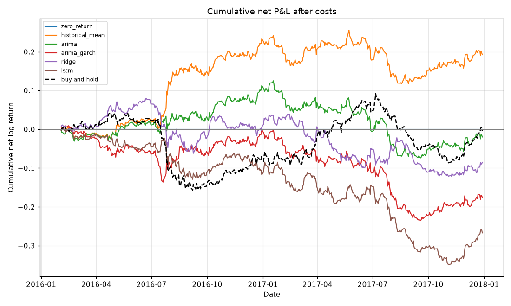
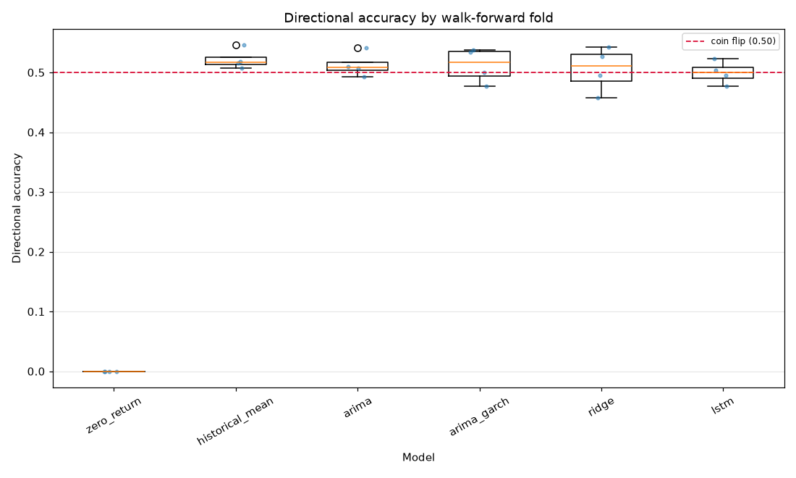
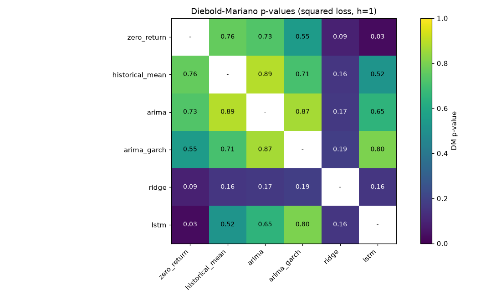

# equity-forecast run `smoke`

## Run metadata

| Field | Value |
| --- | --- |
| Run ID | smoke |
| Tickers | SYNA, SYNB |
| Evaluated range | 2016-02-03 -> 2017-12-29 |
| Folds | 4 |
| Models | zero_return, historical_mean, arima, arima_garch, ridge, lstm |
| Forecast horizon | 1 trading day(s) |
| Split | expanding, 1y initial train, 6m test blocks, 1d embargo |
| Cost assumption | 5.0 bps per unit of turnover; entry threshold 0; vol target none |
| Seed | 42 |

## Headline

| Model | RMSE (mean±std) | DirAcc (mean±std) | IC (mean±std) | DM p vs ZeroReturn | Net Sharpe | Max DD | Avg turnover |
| --- | --- | --- | --- | --- | --- | --- | --- |
| zero_return | 0.00951 ± 0.00138 | 0.0000 ± 0.0000 | n/a | n/a | 0.00 | 0.0000 | 0.000 |
| historical_mean | 0.00952 ± 0.00140 | 0.5218 ± 0.0164 | 0.0354 ± 0.0366 | 0.762 | 0.90 | 0.1384 | 0.002 |
| arima | 0.00952 ± 0.00142 | 0.5127 ± 0.0208 | 0.0679 ± 0.0464 | 0.729 | -0.09 | 0.1990 | 0.189 |
| arima_garch | 0.00953 ± 0.00139 | 0.5121 ± 0.0289 | 0.0276 ± 0.0537 | 0.549 | -0.78 | 0.2440 | 0.424 |
| ridge | 0.00963 ± 0.00143 | 0.5054 ± 0.0375 | 0.0346 ± 0.0660 | 0.091 | -0.39 | 0.2004 | 0.833 |
| lstm | 0.00954 ± 0.00139 | 0.4997 ± 0.0192 | -0.0088 ± 0.0412 | 0.030 | -1.23 | 0.3519 | 0.207 |

_RMSE, DirAcc and IC are means ± standard deviations across the 4 walk-forward folds. `DM p vs ZeroReturn` is the Diebold-Mariano p-value of the model's squared forecast errors against the zero_return baseline; a value above 0.05 means the difference is indistinguishable from noise. Net Sharpe, max drawdown and average turnover come from the cost-aware backtest. `zero_return` shows DirAcc 0.00 by construction, not because it is anti-predictive: it forecasts exactly zero, expressing no direction at all, and an exactly-zero forecast is scored as a miss rather than credited with a coin flip. Its IC is undefined for the same reason - a constant forecast has no rank correlation._

## Findings

1. Per-fold directional accuracy: historical_mean above 0.50 in 4/4 folds (mean 0.522), closer to the truth than zero_return in 1/4 folds; arima above 0.50 in 3/4 folds (mean 0.513), closer to the truth than zero_return in 1/4 folds; arima_garch above 0.50 in 2/4 folds (mean 0.512), closer to the truth than zero_return in 2/4 folds; ridge above 0.50 in 2/4 folds (mean 0.505), closer to the truth than zero_return in 2/4 folds; lstm above 0.50 in 2/4 folds (mean 0.500), closer to the truth than zero_return in 1/4 folds.
2. Diebold-Mariano vs ZeroReturn (squared loss): lstm is significantly WORSE than the baseline - the difference is real, but it runs the wrong way; no model beats it. All p-values: historical_mean p=0.762, arima p=0.729, arima_garch p=0.549, ridge p=0.091, lstm p=0.030.
3. Best net Sharpe among the trading models: historical_mean at 0.90 (gross 0.90, a 0.00 give-up); average daily turnover of 0.00 at 5.0 bps costs roughly 3 bps of return per year; the do-nothing zero_return book scores 0.00; buy-and-hold over the same window scores -0.02. That P&L survives the cost drag, but at 0.002 average daily turnover it is close to a static position: it is capturing drift, not reacting to a forecast. Whether any accuracy edge supports it is the bottom line's question.
4. Mean information coefficient (Spearman) per model across folds: historical_mean +0.0354, arima +0.0679, arima_garch +0.0276, ridge +0.0346, lstm -0.0088. The strongest (arima) has a fold-level t-statistic of 2.93 over 4 folds (p=0.061), i.e. not distinguishable from zero at the 5% level. Read that p-value as an order of magnitude, not as inference: walk-forward folds share most of their training data so their ICs are not independent, and this is the best of 5 models, which biases it upward. The Diebold-Mariano tests on the daily series are the significance claims this report stands behind.
5. Bottom line: the best strategy (historical_mean) earns a net Sharpe of 0.90 after 5.0 bps of costs, but no model's forecast errors beat the ZeroReturn baseline, so that P&L is not supported by a measurable accuracy edge - on this evidence it is drift or luck, not skill. Treat it as unproven. lstm is significantly worse than the baseline.

## Walk-forward folds

| fold_id | train_start | train_end | test_start | test_end | n_train_days | n_test_days |
| --- | --- | --- | --- | --- | --- | --- |
| 0 | 2015-02-02 | 2016-02-01 | 2016-02-03 | 2016-08-02 | 261 | 130 |
| 1 | 2015-02-02 | 2016-08-01 | 2016-08-03 | 2017-02-02 | 391 | 132 |
| 2 | 2015-02-02 | 2017-02-01 | 2017-02-03 | 2017-08-02 | 523 | 129 |
| 3 | 2015-02-02 | 2017-08-01 | 2017-08-03 | 2017-12-29 | 652 | 107 |

## Backtest

| model | gross_ann_return | gross_ann_vol | gross_sharpe | gross_sortino | gross_max_drawdown | gross_avg_turnover | gross_pct_days_in_market | gross_total_return | gross_n_days | net_ann_return | net_ann_vol | net_sharpe | net_sortino | net_max_drawdown | net_avg_turnover | net_pct_days_in_market | net_total_return | net_n_days |
| --- | --- | --- | --- | --- | --- | --- | --- | --- | --- | --- | --- | --- | --- | --- | --- | --- | --- | --- |
| zero_return | 0 | 0 | 0 | 0 | 0 | 0 | 0 | 0 | 498 | 0 | 0 | 0 | 0 | 0 | 0 | 0 | 0 | 498 |
| historical_mean | 0.0976 | 0.1086 | 0.8989 | 1.3504 | 0.1384 | 0.002 | 1 | 0.1929 | 498 | 0.0973 | 0.1086 | 0.8967 | 1.3469 | 0.1384 | 0.002 | 1 | 0.1924 | 498 |
| arima | 0.0137 | 0.1069 | 0.1279 | 0.1741 | 0.182 | 0.1888 | 1 | 0.027 | 498 | -0.0101 | 0.1071 | -0.0944 | -0.1271 | 0.199 | 0.1888 | 1 | -0.02 | 498 |
| arima_garch | -0.0357 | 0.1135 | -0.3147 | -0.4334 | 0.1986 | 0.4237 | 1 | -0.0706 | 498 | -0.0891 | 0.1138 | -0.7827 | -1.0551 | 0.244 | 0.4237 | 1 | -0.1761 | 498 |
| ridge | 0.0619 | 0.1114 | 0.5554 | 0.8119 | 0.1215 | 0.8333 | 1 | 0.1223 | 498 | -0.0431 | 0.1113 | -0.3873 | -0.5428 | 0.2004 | 0.8333 | 1 | -0.0852 | 498 |
| lstm | -0.1092 | 0.1095 | -0.9971 | -1.3097 | 0.3009 | 0.2068 | 1 | -0.2158 | 498 | -0.1353 | 0.1096 | -1.2341 | -1.6037 | 0.3519 | 0.2068 | 1 | -0.2673 | 498 |

## Figures

### Cumulative net P&L

### Per-fold directional accuracy

### Rolling annualised Sharpe (net)

### Pairwise Diebold-Mariano p-values (cross-sectional, one obs/day)

