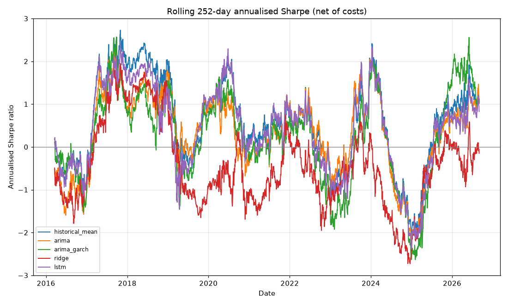

# equity-forecast run `synthetic-efficient`

> SIMULATED DATA - NOT A MARKET RESULT. Prices come from scripts/make_synthetic_universe.py, not from Yahoo Finance, because the environment this package was built in had no market-data egress. The data-generating process has GARCH(1,1) conditional variance, Student-t(5) innovations and a common factor, but no exploitable predictability in the conditional mean, so the expected result is that nothing beats the random-walk baseline. See results/control/summary.md for the positive control that shows this harness does detect signal when signal is present.

## Run metadata

| Field | Value |
| --- | --- |
| Run ID | synthetic-efficient |
| Tickers | SIMA, SIMB, SIMC, SIMD, SIME, SIMF |
| Evaluated range | 2015-04-02 -> 2026-09-01 |
| Folds | 23 |
| Models | zero_return, historical_mean, arima, arima_garch, ridge, lstm |
| Forecast horizon | 1 trading day(s) |
| Split | expanding, 5y initial train, 6m test blocks, 1d embargo |
| Cost assumption | 5.0 bps per unit of turnover; entry threshold 0; vol target none |
| Seed | 42 |

## Headline

| Model | RMSE (mean±std) | DirAcc (mean±std) | IC (mean±std) | DM p vs ZeroReturn | Net Sharpe | Max DD | Avg turnover |
| --- | --- | --- | --- | --- | --- | --- | --- |
| zero_return | 0.01329 ± 0.00450 | 0.0000 ± 0.0000 | n/a | n/a | 0.00 | 0.0000 | 0.000 |
| historical_mean | 0.01329 ± 0.00449 | 0.5174 ± 0.0310 | 0.0075 ± 0.0270 | 0.453 | 0.74 | 0.3248 | 0.000 |
| arima | 0.01330 ± 0.00449 | 0.5124 ± 0.0263 | -0.0022 ± 0.0403 | 0.655 | 0.42 | 0.3380 | 0.188 |
| arima_garch | 0.01329 ± 0.00451 | 0.5138 ± 0.0248 | 0.0083 ± 0.0499 | 0.626 | 0.31 | 0.3761 | 0.343 |
| ridge | 0.01334 ± 0.00455 | 0.5046 ± 0.0222 | -0.0156 ± 0.0588 | 0.104 | -0.18 | 0.8981 | 0.778 |
| lstm | 0.01330 ± 0.00449 | 0.5141 ± 0.0308 | 0.0026 ± 0.0409 | 0.975 | 0.60 | 0.3344 | 0.082 |

_RMSE, DirAcc and IC are means ± standard deviations across the 23 walk-forward folds. `DM p vs ZeroReturn` is the Diebold-Mariano p-value of the model's squared forecast errors against the zero_return baseline; a value above 0.05 means the difference is indistinguishable from noise. Net Sharpe, max drawdown and average turnover come from the cost-aware backtest. `zero_return` shows DirAcc 0.00 by construction, not because it is anti-predictive: it forecasts exactly zero, expressing no direction at all, and an exactly-zero forecast is scored as a miss rather than credited with a coin flip. Its IC is undefined for the same reason - a constant forecast has no rank correlation._

## Findings

1. Per-fold directional accuracy: historical_mean above 0.50 in 16/23 folds (mean 0.517), closer to the truth than zero_return in 13/23 folds; arima above 0.50 in 17/23 folds (mean 0.512), closer to the truth than zero_return in 11/23 folds; arima_garch above 0.50 in 16/23 folds (mean 0.514), closer to the truth than zero_return in 13/23 folds; ridge above 0.50 in 12/23 folds (mean 0.505), closer to the truth than zero_return in 7/23 folds; lstm above 0.50 in 14/23 folds (mean 0.514), closer to the truth than zero_return in 11/23 folds.
2. Diebold-Mariano vs ZeroReturn (squared loss): no model's forecast errors are distinguishable from the baseline at the 5% level - the smallest p-value is 0.104 (ridge). All p-values: historical_mean p=0.453, arima p=0.655, arima_garch p=0.626, ridge p=0.104, lstm p=0.975.
3. Best net Sharpe among the trading models: historical_mean at 0.74 (gross 0.74, a 0.00 give-up); average daily turnover of 0.00 at 5.0 bps costs roughly 0 bps of return per year; the do-nothing zero_return book scores 0.00; buy-and-hold over the same window scores 0.74. That P&L survives the cost drag, but at 0.000 average daily turnover it is close to a static position: it is capturing drift, not reacting to a forecast. Whether any accuracy edge supports it is the bottom line's question.
4. Mean information coefficient (Spearman) per model across folds: historical_mean +0.0075, arima -0.0022, arima_garch +0.0083, ridge -0.0156, lstm +0.0026. The strongest (arima_garch) has a fold-level t-statistic of 0.80 over 23 folds (p=0.433), i.e. not distinguishable from zero at the 5% level. Read that p-value as an order of magnitude, not as inference: walk-forward folds share most of their training data so their ICs are not independent, and this is the best of 5 models, which biases it upward. The Diebold-Mariano tests on the daily series are the significance claims this report stands behind.
5. Bottom line: the best strategy (historical_mean) earns a net Sharpe of 0.74 after 5.0 bps of costs, but no model's forecast errors beat the ZeroReturn baseline, so that P&L is not supported by a measurable accuracy edge - on this evidence it is drift or luck, not skill. Treat it as unproven.

## Walk-forward folds

| fold_id | train_start | train_end | test_start | test_end | n_train_days | n_test_days |
| --- | --- | --- | --- | --- | --- | --- |
| 0 | 2010-04-01 | 2015-03-31 | 2015-04-02 | 2015-10-01 | 1304 | 131 |
| 1 | 2010-04-01 | 2015-09-30 | 2015-10-02 | 2016-04-01 | 1435 | 131 |
| 2 | 2010-04-01 | 2016-03-31 | 2016-04-04 | 2016-09-30 | 1566 | 130 |
| 3 | 2010-04-01 | 2016-09-29 | 2016-10-03 | 2017-03-31 | 1696 | 130 |
| 4 | 2010-04-01 | 2017-03-30 | 2017-04-03 | 2017-09-29 | 1826 | 130 |
| 5 | 2010-04-01 | 2017-09-28 | 2017-10-02 | 2018-03-30 | 1956 | 130 |
| 6 | 2010-04-01 | 2018-03-29 | 2018-04-02 | 2018-10-01 | 2086 | 131 |
| 7 | 2010-04-01 | 2018-09-28 | 2018-10-02 | 2019-04-01 | 2217 | 130 |
| 8 | 2010-04-01 | 2019-03-29 | 2019-04-02 | 2019-10-01 | 2347 | 131 |
| 9 | 2010-04-01 | 2019-09-30 | 2019-10-02 | 2020-04-01 | 2478 | 131 |
| 10 | 2010-04-01 | 2020-03-31 | 2020-04-02 | 2020-10-01 | 2609 | 131 |
| 11 | 2010-04-01 | 2020-09-30 | 2020-10-02 | 2021-04-01 | 2740 | 130 |
| 12 | 2010-04-01 | 2021-03-31 | 2021-04-02 | 2021-10-01 | 2870 | 131 |
| 13 | 2010-04-01 | 2021-09-30 | 2021-10-04 | 2022-04-01 | 3001 | 130 |
| 14 | 2010-04-01 | 2022-03-31 | 2022-04-04 | 2022-09-30 | 3131 | 130 |
| 15 | 2010-04-01 | 2022-09-29 | 2022-10-03 | 2023-03-31 | 3261 | 130 |
| 16 | 2010-04-01 | 2023-03-30 | 2023-04-03 | 2023-09-29 | 3391 | 130 |
| 17 | 2010-04-01 | 2023-09-28 | 2023-10-02 | 2024-04-01 | 3521 | 131 |
| 18 | 2010-04-01 | 2024-03-29 | 2024-04-02 | 2024-10-01 | 3652 | 131 |
| 19 | 2010-04-01 | 2024-09-30 | 2024-10-02 | 2025-04-01 | 3783 | 130 |
| 20 | 2010-04-01 | 2025-03-31 | 2025-04-02 | 2025-10-01 | 3913 | 131 |
| 21 | 2010-04-01 | 2025-09-30 | 2025-10-02 | 2026-04-01 | 4044 | 130 |
| 22 | 2010-04-01 | 2026-03-31 | 2026-04-02 | 2026-09-01 | 4174 | 109 |

## Backtest

| model | gross_ann_return | gross_ann_vol | gross_sharpe | gross_sortino | gross_max_drawdown | gross_avg_turnover | gross_pct_days_in_market | gross_total_return | gross_n_days | net_ann_return | net_ann_vol | net_sharpe | net_sortino | net_max_drawdown | net_avg_turnover | net_pct_days_in_market | net_total_return | net_n_days |
| --- | --- | --- | --- | --- | --- | --- | --- | --- | --- | --- | --- | --- | --- | --- | --- | --- | --- | --- |
| zero_return | 0 | 0 | 0 | 0 | 0 | 0 | 0 | 0 | 2979 | 0 | 0 | 0 | 0 | 0 | 0 | 0 | 0 | 2979 |
| historical_mean | 0.1302 | 0.1749 | 0.7446 | 1.1334 | 0.3248 | 0.0003 | 1 | 1.5392 | 2979 | 0.1302 | 0.1749 | 0.7444 | 1.133 | 0.3248 | 0.0003 | 1 | 1.5387 | 2979 |
| arima | 0.0863 | 0.1485 | 0.5808 | 0.8611 | 0.3262 | 0.1882 | 1 | 1.0196 | 2979 | 0.0625 | 0.1485 | 0.4211 | 0.6198 | 0.338 | 0.1882 | 1 | 0.7393 | 2979 |
| arima_garch | 0.0859 | 0.1357 | 0.6329 | 0.9359 | 0.3407 | 0.3427 | 1 | 1.0155 | 2979 | 0.0427 | 0.1358 | 0.3146 | 0.4586 | 0.3761 | 0.3427 | 1 | 0.505 | 2979 |
| ridge | 0.0701 | 0.1511 | 0.4637 | 0.6996 | 0.2935 | 0.7779 | 1 | 0.8284 | 2979 | -0.0279 | 0.1513 | -0.1847 | -0.2716 | 0.8981 | 0.7779 | 1 | -0.3303 | 2979 |
| lstm | 0.1109 | 0.1666 | 0.6656 | 1.0081 | 0.3264 | 0.0818 | 1 | 1.311 | 2979 | 0.1006 | 0.1667 | 0.6036 | 0.9122 | 0.3344 | 0.0818 | 1 | 1.1891 | 2979 |

## Figures

### Cumulative net P&L

### Per-fold directional accuracy

### Rolling annualised Sharpe (net)

### Pairwise Diebold-Mariano p-values (cross-sectional, one obs/day)

