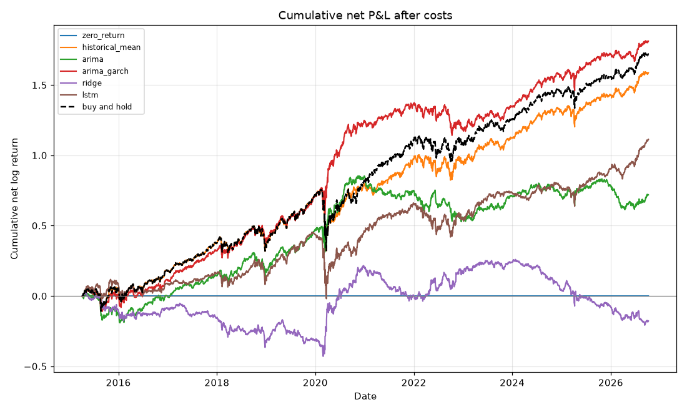
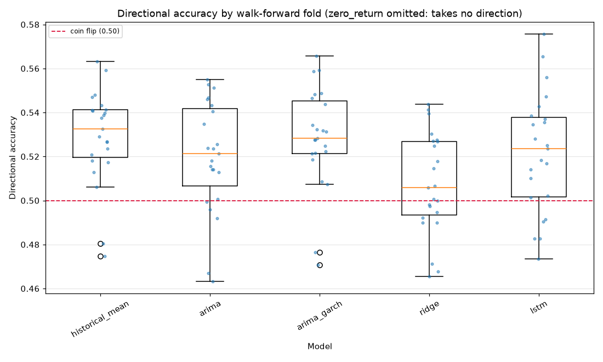
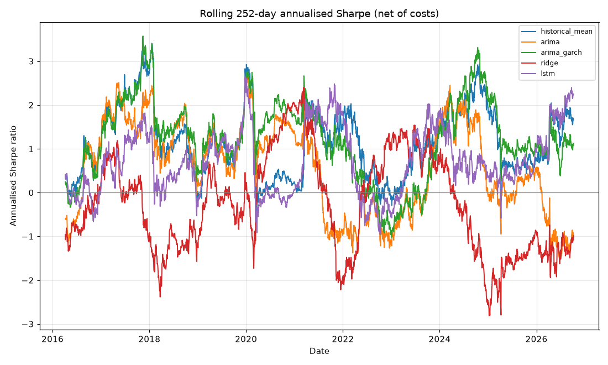
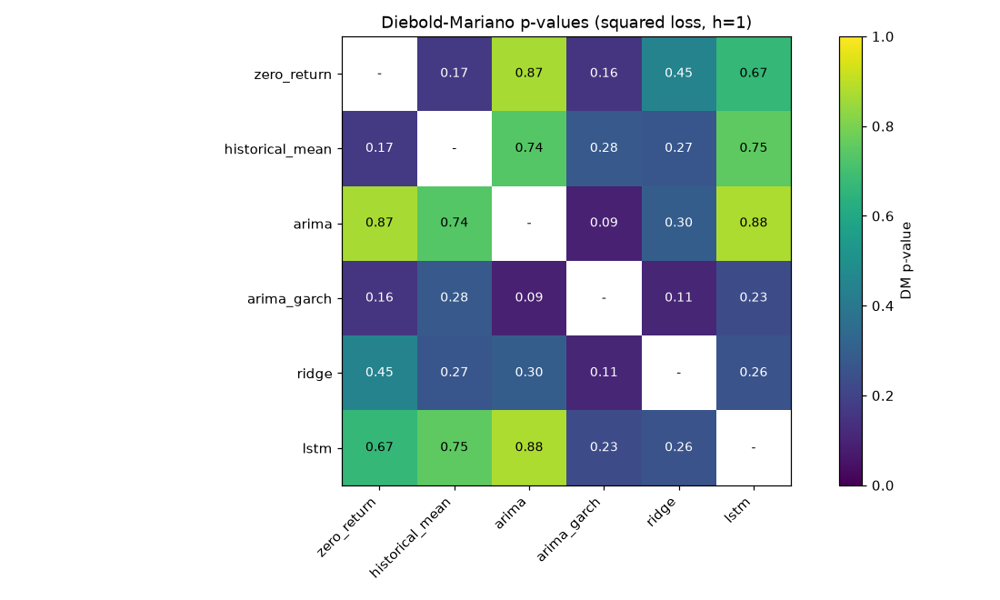

# equity-forecast run `regimes-default`

## Run metadata

| Field | Value |
| --- | --- |
| Run ID | regimes-default |
| Tickers | AAPL, JPM, KO, XOM, MSFT, PG |
| Evaluated range | 2015-04-08 -> 2026-10-07 |
| Folds | 23 |
| Models | zero_return, historical_mean, arima, arima_garch, ridge, lstm |
| Forecast horizon | 1 trading day(s) |
| Split | expanding, 5y initial train, 6m test blocks, 1d embargo |
| Cost assumption | 5.0 bps per unit of turnover; entry threshold 0; vol target none |
| Seed | 42 |

## Headline

| Model | RMSE (mean±std) | DirAcc (mean±std) | IC (mean±std) | DM p vs ZeroReturn | Net Sharpe | Max DD | Avg turnover |
| --- | --- | --- | --- | --- | --- | --- | --- |
| zero_return | 0.01502 ± 0.00480 | 0.0000 ± 0.0000 | n/a | n/a | 0.00 | 0.0000 | 0.000 |
| historical_mean | 0.01500 ± 0.00481 | 0.5291 ± 0.0215 | 0.0191 ± 0.0436 | 0.169 | 0.84 | 0.4337 | 0.001 |
| arima | 0.01502 ± 0.00477 | 0.5199 ± 0.0254 | 0.0192 ± 0.0645 | 0.869 | 0.44 | 0.3260 | 0.607 |
| arima_garch | 0.01500 ± 0.00478 | 0.5285 ± 0.0232 | 0.0222 ± 0.0544 | 0.156 | 1.03 | 0.2330 | 0.181 |
| ridge | 0.01506 ± 0.00475 | 0.5075 ± 0.0229 | 0.0070 ± 0.0477 | 0.449 | -0.12 | 0.4679 | 0.965 |
| lstm | 0.01501 ± 0.00482 | 0.5214 ± 0.0272 | 0.0236 ± 0.0462 | 0.667 | 0.59 | 0.4730 | 0.165 |

_RMSE, DirAcc and IC are means ± standard deviations across the 23 walk-forward folds. `DM p vs ZeroReturn` is the Diebold-Mariano p-value of the model's squared forecast errors against the zero_return baseline; a value above 0.05 means the difference is indistinguishable from noise. Net Sharpe, max drawdown and average turnover come from the cost-aware backtest. `zero_return` shows DirAcc 0.00 by construction, not because it is anti-predictive: it forecasts exactly zero, expressing no direction at all, and an exactly-zero forecast is scored as a miss rather than credited with a coin flip. Its IC is undefined for the same reason - a constant forecast has no rank correlation._

## Findings

1. Per-fold directional accuracy: historical_mean above 0.50 in 21/23 folds (mean 0.529), closer to the truth than zero_return in 21/23 folds; arima above 0.50 in 18/23 folds (mean 0.520), closer to the truth than zero_return in 13/23 folds; arima_garch above 0.50 in 21/23 folds (mean 0.529), closer to the truth than zero_return in 17/23 folds; ridge above 0.50 in 13/23 folds (mean 0.508), closer to the truth than zero_return in 7/23 folds; lstm above 0.50 in 18/23 folds (mean 0.521), closer to the truth than zero_return in 16/23 folds.
2. Diebold-Mariano vs ZeroReturn (squared loss): no model's forecast errors are distinguishable from the baseline at the 5% level - the smallest p-value is 0.156 (arima_garch). All p-values: historical_mean p=0.169, arima p=0.869, arima_garch p=0.156, ridge p=0.449, lstm p=0.667.
3. Best net Sharpe among the trading models: arima_garch at 1.03 (gross 1.18, a 0.15 give-up); average daily turnover of 0.18 at 5.0 bps costs roughly 228 bps of return per year; the do-nothing zero_return book scores 0.00; buy-and-hold over the same window scores 0.87. That P&L survives the cost drag. Whether any accuracy edge supports it is the bottom line's question.
4. Mean information coefficient (Spearman) per model across folds: historical_mean +0.0191, arima +0.0192, arima_garch +0.0222, ridge +0.0070, lstm +0.0236. The strongest (lstm) has a fold-level t-statistic of 2.45 over 23 folds (p=0.023), i.e. distinguishable from zero at the 5% level. Read that p-value as an order of magnitude, not as inference: walk-forward folds share most of their training data so their ICs are not independent, and this is the best of 5 models, which biases it upward. The Diebold-Mariano tests on the daily series are the significance claims this report stands behind.
5. Bottom line: the best strategy (arima_garch) earns a net Sharpe of 1.03 after 5.0 bps of costs, but no model's forecast errors beat the ZeroReturn baseline, so that P&L is not supported by a measurable accuracy edge - on this evidence it is drift or luck, not skill. Treat it as unproven.

## Walk-forward folds

| fold_id | train_start | train_end | test_start | test_end | n_train_days | n_test_days |
| --- | --- | --- | --- | --- | --- | --- |
| 0 | 2010-04-07 | 2015-04-06 | 2015-04-08 | 2015-10-07 | 1258 | 128 |
| 1 | 2010-04-07 | 2015-10-06 | 2015-10-08 | 2016-04-07 | 1386 | 125 |
| 2 | 2010-04-07 | 2016-04-06 | 2016-04-08 | 2016-10-07 | 1511 | 128 |
| 3 | 2010-04-07 | 2016-10-06 | 2016-10-10 | 2017-04-07 | 1639 | 125 |
| 4 | 2010-04-07 | 2017-04-06 | 2017-04-10 | 2017-10-06 | 1764 | 126 |
| 5 | 2010-04-07 | 2017-10-05 | 2017-10-09 | 2018-04-06 | 1890 | 124 |
| 6 | 2010-04-07 | 2018-04-05 | 2018-04-09 | 2018-10-05 | 2014 | 127 |
| 7 | 2010-04-07 | 2018-10-04 | 2018-10-08 | 2019-04-05 | 2141 | 124 |
| 8 | 2010-04-07 | 2019-04-04 | 2019-04-08 | 2019-10-07 | 2265 | 127 |
| 9 | 2010-04-07 | 2019-10-04 | 2019-10-08 | 2020-04-07 | 2392 | 126 |
| 10 | 2010-04-07 | 2020-04-06 | 2020-04-08 | 2020-10-07 | 2518 | 127 |
| 11 | 2010-04-07 | 2020-10-06 | 2020-10-08 | 2021-04-07 | 2645 | 124 |
| 12 | 2010-04-07 | 2021-04-06 | 2021-04-08 | 2021-10-07 | 2769 | 128 |
| 13 | 2010-04-07 | 2021-10-06 | 2021-10-08 | 2022-04-07 | 2897 | 126 |
| 14 | 2010-04-07 | 2022-04-06 | 2022-04-08 | 2022-10-07 | 3023 | 126 |
| 15 | 2010-04-07 | 2022-10-06 | 2022-10-10 | 2023-04-06 | 3149 | 124 |
| 16 | 2010-04-07 | 2023-04-05 | 2023-04-10 | 2023-10-06 | 3273 | 126 |
| 17 | 2010-04-07 | 2023-10-05 | 2023-10-09 | 2024-04-05 | 3399 | 124 |
| 18 | 2010-04-07 | 2024-04-04 | 2024-04-08 | 2024-10-07 | 3523 | 127 |
| 19 | 2010-04-07 | 2024-10-04 | 2024-10-08 | 2025-04-07 | 3650 | 124 |
| 20 | 2010-04-07 | 2025-04-04 | 2025-04-08 | 2025-10-07 | 3774 | 126 |
| 21 | 2010-04-07 | 2025-10-06 | 2025-10-08 | 2026-04-07 | 3900 | 124 |
| 22 | 2010-04-07 | 2026-04-06 | 2026-04-08 | 2026-10-07 | 4024 | 127 |

## Backtest

| model | gross_ann_return | gross_ann_vol | gross_sharpe | gross_sortino | gross_max_drawdown | gross_avg_turnover | gross_pct_days_in_market | gross_total_return | gross_n_days | net_ann_return | net_ann_vol | net_sharpe | net_sortino | net_max_drawdown | net_avg_turnover | net_pct_days_in_market | net_total_return | net_n_days |
| --- | --- | --- | --- | --- | --- | --- | --- | --- | --- | --- | --- | --- | --- | --- | --- | --- | --- | --- |
| zero_return | 0 | 0 | 0 | 0 | 0 | 0 | 0 | 0 | 2893 | 0 | 0 | 0 | 0 | 0 | 0 | 0 | 0 | 2893 |
| historical_mean | 0.1384 | 0.1652 | 0.8377 | 1.1754 | 0.4337 | 0.0006 | 1 | 1.5883 | 2893 | 0.1383 | 0.1652 | 0.8373 | 1.1747 | 0.4337 | 0.0006 | 1 | 1.5875 | 2893 |
| arima | 0.1391 | 0.1412 | 0.9852 | 1.4389 | 0.1819 | 0.6066 | 1 | 1.5969 | 2893 | 0.0627 | 0.1413 | 0.4436 | 0.6335 | 0.326 | 0.6066 | 1 | 0.7194 | 2893 |
| arima_garch | 0.1807 | 0.1534 | 1.178 | 1.7195 | 0.2132 | 0.1812 | 1 | 2.0745 | 2893 | 0.1579 | 0.1534 | 1.0293 | 1.4911 | 0.233 | 0.1812 | 1 | 1.8123 | 2893 |
| ridge | 0.1061 | 0.133 | 0.7983 | 1.2617 | 0.1927 | 0.9651 | 1 | 1.2184 | 2893 | -0.0155 | 0.133 | -0.1163 | -0.176 | 0.4679 | 0.9651 | 1 | -0.1776 | 2893 |
| lstm | 0.1178 | 0.1651 | 0.7137 | 1.0065 | 0.4682 | 0.165 | 1 | 1.3525 | 2893 | 0.097 | 0.1651 | 0.5876 | 0.8259 | 0.473 | 0.165 | 1 | 1.1139 | 2893 |

## Volatility regimes

Each test date is labelled low / mid / high by the cross-sectional mean of trailing realised volatility known before the forecast, against terciles of the same signal over that fold's training dates (no look-ahead). `rmse_vs_zero` below 1 means lower error than the baseline; `dm_p_holm` is the DM p-value after Holm correction across every model and regime. Test dates per regime: low 826, mid 834, high 1233.

| regime | model | n_dates | n_obs | rmse | rmse_vs_zero | dir_acc | ic | dm_stat_vs_zero | dm_p_vs_zero | dm_p_holm | net_sharpe | net_ann_return |
| --- | --- | --- | --- | --- | --- | --- | --- | --- | --- | --- | --- | --- |
| low | zero_return | 826 | 4956 | 0.0107 | 1 | 0 | n/a | n/a | n/a | n/a | n/a | 0 |
| low | historical_mean | 826 | 4956 | 0.0107 | 0.9988 | 0.5239 | 0.0275 | -1.1287 | 0.2593 | 1 | 1.2363 | 0.1186 |
| low | arima | 826 | 4956 | 0.0107 | 0.9989 | 0.5289 | 0.0381 | -0.7841 | 0.4332 | 1 | 1.2346 | 0.1087 |
| low | arima_garch | 826 | 4956 | 0.0107 | 0.9989 | 0.5241 | 0.0418 | -0.7481 | 0.4546 | 1 | 1.3285 | 0.1235 |
| low | ridge | 826 | 4956 | 0.0107 | 1.0015 | 0.5101 | 0.0195 | 0.8787 | 0.3798 | 1 | -0.2829 | -0.0218 |
| low | lstm | 826 | 4956 | 0.0107 | 0.9987 | 0.5216 | 0.0287 | -1.6414 | 0.1011 | 1 | 0.9725 | 0.0808 |
| low | buy_and_hold | 826 | n/a | n/a | n/a | n/a | n/a | n/a | n/a | n/a | 1.2363 | 0.1186 |
| mid | zero_return | 834 | 5004 | 0.0126 | 1 | 0 | n/a | n/a | n/a | n/a | n/a | 0 |
| mid | historical_mean | 834 | 5004 | 0.0126 | 0.9984 | 0.5321 | 0.0243 | -1.7061 | 0.0884 | 1 | 1.4457 | 0.172 |
| mid | arima | 834 | 5004 | 0.0127 | 1.0012 | 0.5193 | 0.0097 | 0.7028 | 0.4824 | 1 | 0.2633 | 0.028 |
| mid | arima_garch | 834 | 5004 | 0.0126 | 0.9992 | 0.5303 | 0.0133 | -0.5236 | 0.6007 | 1 | 1.1842 | 0.1357 |
| mid | ridge | 834 | 5004 | 0.0127 | 1.0079 | 0.4986 | -0.0197 | 3.5547 | 0.0004 | 0.006 | -1.7468 | -0.1683 |
| mid | lstm | 834 | 5004 | 0.0126 | 0.9989 | 0.5199 | 0.0234 | -1.0455 | 0.2961 | 1 | 0.8726 | 0.0964 |
| mid | buy_and_hold | 834 | n/a | n/a | n/a | n/a | n/a | n/a | n/a | n/a | 1.4466 | 0.1719 |
| high | zero_return | 1233 | 7398 | 0.0199 | 1 | 0 | n/a | n/a | n/a | n/a | n/a | 0 |
| high | historical_mean | 1233 | 7398 | 0.0199 | 0.9997 | 0.5305 | -0.0031 | -0.4379 | 0.6616 | 1 | 0.5855 | 0.1287 |
| high | arima | 1233 | 7398 | 0.0199 | 0.9996 | 0.5144 | 0.0097 | -0.2283 | 0.8195 | 1 | 0.2998 | 0.0553 |
| high | arima_garch | 1233 | 7398 | 0.0199 | 0.9984 | 0.5302 | 0.0206 | -1.1934 | 0.2329 | 1 | 0.9727 | 0.1958 |
| high | ridge | 1233 | 7398 | 0.0199 | 1.0001 | 0.5118 | 0.0261 | 0.022 | 0.9824 | 1 | 0.522 | 0.0922 |
| high | lstm | 1233 | 7398 | 0.0199 | 0.9999 | 0.5225 | 0.0009 | -0.039 | 0.9689 | 1 | 0.4791 | 0.1083 |
| high | buy_and_hold | 1233 | n/a | n/a | n/a | n/a | n/a | n/a | n/a | n/a | 0.6748 | 0.1559 |

- **low volatility:** no model beats zero_return after Holm correction. Lowest error ratio: lstm (0.9987 of zero_return's RMSE).
- **mid volatility:** no model beats zero_return after Holm correction; ridge significantly worse. Lowest error ratio: historical_mean (0.9984 of zero_return's RMSE).
- **high volatility:** no model beats zero_return after Holm correction. Lowest error ratio: arima_garch (0.9984 of zero_return's RMSE).

## Figures

### Cumulative net P&L

### Per-fold directional accuracy

### Rolling annualised Sharpe (net)

### Pairwise Diebold-Mariano p-values (cross-sectional, one obs/day)

